# Prism

English | [简体中文](README.md)

Prism is a personal coding agent built for long-term use. A desktop workbench on Windows
owns tasks, sessions, approvals, and artifacts; the agent works in WSL on your
repository: reading code, editing files, running commands and tests, and verifying
results.

Prism runs its own task loop and ships with a browser tool, MCP, skills, web search, and
cross-session memory. The default model is DeepSeek.

Install: [GitHub Releases](https://github.com/Tulipe1735/Prism/releases/latest)

Docs: [workbench](docs/workbench.md) · [kernel contract](docs/kernel-contract.md) ·
[browser CLI](docs/browser-cli.md) · [architecture](docs/architecture.svg)

## Status

Download the Windows installer from
[GitHub Releases](https://github.com/Tulipe1735/Prism/releases/latest). Install
`Prism-<version>-Setup-x64.exe`, open Prism, choose an initialized WSL Linux
distribution, and enter your model settings. The kernel and Node runtime ship with the
app; no source checkout is required. See [installation and usage](docs/workbench.md) for
the full steps.

Prism iterates quickly; kernel interfaces and the UI may change between versions.

## Run

### Windows installer

1. Download and install `Prism-<version>-Setup-x64.exe` from
   [Releases](https://github.com/Tulipe1735/Prism/releases/latest).
2. Open Prism and choose an initialized WSL Linux distribution.
3. Enter the model endpoint, name, and key, then choose a WSL workspace.

Requires Windows x64 and an x86_64 WSL Linux distribution (Ubuntu recommended). The
first browser download needs network access; if system dependencies are missing, follow
the prompts in the preparation log.

### From source

Requires Node.js ≥22.23.2 and pnpm:

```bash
pnpm install
pnpm build
pnpm workbench
```

`pnpm workbench` starts a kernel, prints its local URL, and serves the same UI in a
browser for development and acceptance work. For the Electron entry, Windows packaging,
and runtime preparation, see [workbench](docs/workbench.md).

## Capabilities

- **Desktop workbench**: workspaces, sessions, streaming chat, tool activity, code
  changes, task artifacts, approvals, and settings. The UI uses React + Tailwind CSS,
  Inter, neutral cool greys, and a blue accent. No built-in editor, file tree, or
  interactive terminal.
- **Full development loop**: read and write files, run commands and tests in a WSL
  workspace, with verifiable results.
- **Browser capability**: observation, target references, action validation, and input
  receipts. The built-in agent uses it directly; the `prism` CLI exposes it to external
  agents.
- **MCP**: connect external tool servers, configured in [mcp.json](docs/mcp.md).
- **Skills**: loaded on demand from directory conventions, described in
  [skills](docs/skills.md).
- **Web search**: built-in `web_search` and `web_fetch`, DeepSeek by default,
  configurable.
- **Cross-session memory**: session history is persisted, resumable, and compactable.
- **Permission boundary**: three scopes (read-only / workspace-write / full access) with
  out-of-scope approvals granted once; modeled after
  [DeepSeek Harness](https://github.com/deepseek-ai/deepseek-harness).
- **Model**: DeepSeek API by default; any OpenAI-compatible endpoint can be configured.

## Browser CLI

`prism` is a browser-use CLI for external agents. It does not call a model; it observes
the browser, validates action references, and executes one input at a time. Install it:

```bash
npm install -g @tulipe1735/prism
prism --help
```

For usage and agent setup, see the [browser guide](docs/browser-cli.md). The agent skill
is in [skills/prism](skills/prism/SKILL.md).

## Architecture



The Electron interface runs on Windows; the kernel runs in WSL. The two communicate over
local HTTP/SSE, and the desktop starts the kernel through `wsl.exe`. See
[ADR-0001](docs/adr/0001-windows-ui-wsl-execution.md).

[Editable Excalidraw source](docs/architecture.excalidraw) · [Glossary](GLOSSARY.md) ·
[Requirements](docs/requirements-2026-10-18-coding-agent.md)

Code: [workbench](src/workbench) · [kernel](src/kernel) · [browser](src/browser) ·
[browser CLI](src/interfaces/cli.ts)

## Development

```bash
pnpm install
pnpm typecheck
pnpm test
pnpm build
```

See [workbench](docs/workbench.md) for how to run and read the workbench, and
[acceptance](docs/acceptance.md) for a first-version acceptance run with real tasks.

The kernel starts headless, listens on `127.0.0.1` and prints its address as one JSON
line (interface in [docs/kernel-contract.md](docs/kernel-contract.md)):

```bash
node --experimental-strip-types --disable-warning=ExperimentalWarning \
  src/interfaces/kernel.ts [--port <n>] [--data-dir <path>]
```

MIT License. The README follows the structure of
[DeepSeek Harness](https://github.com/deepseek-ai/deepseek-harness).
