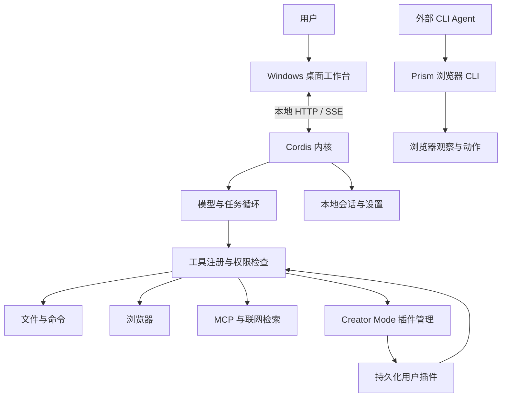

# 架构与当前范围

Prism 当前交付 Windows 桌面工作台、可在 Windows 或 WSL 运行的 Cordis 内核，以及独立的浏览器 CLI。

## 内核与工作台

`src/kernel/plugins/index.ts`
装配模型、会话、权限、任务、文件、命令、浏览器、联网、MCP、skills 和 Creator
Mode。内置能力与用户插件都由 Cordis 管理生命周期。每轮模型请求读取当前工具列表，新插件因此可在同一会话中使用。

工作台负责交互，不直接操作工作区或调用模型。UI 服务器代理内核请求；Electron 提供运行环境准备、工作区选择、账号与更新入口。内核与数据位于用户选择的 Windows 或 WSL 环境中，详见[执行环境](execution-targets.md)。

会话以 JSONL 保存，条目通过 `id` / `parentId`
关联。压缩保留原始记录，并为后续请求提供摘要。这里的跨会话记忆来自可恢复的会话与指令文件，尚无自动学习或独立语义记忆库。

## 插件与当前边界

Creator
Mode 管理自包含 JavaScript 模块，持久化到数据目录，并在启停、更新和关闭时释放注册。插件可以注册工具、订阅已有事件或提供服务。工作台当前没有用户插件 UI 插槽，也没有 DSH 插件兼容层。完整契约见[插件开发](../develop/plugins.md)和[Cordis 生命周期](plugins.md)。

CLI-Anything 集成、WPS 对象级集成、GenUI 以及 Harness² 式自动迭代属于后续探索，不是当前能力。Creator
Mode 允许 Agent 编写插件，不自动构成对 Harness 改动的对照评估与经验积累。

## 浏览器的两个入口

内核浏览器使用 Playwright，为内置 Agent 提供工具。独立 `prism`
CLI 为外部 Agent 提供浏览器观察、目标引用和单步动作接口，不调用模型。两者共享观察与回执语义，分别管理运行入口和会话。

浏览器和执行链路的细节图：[SVG](architecture.svg) ·
[交互 HTML](architecture.html)。Creator Mode 的调用关系以本页为准。
